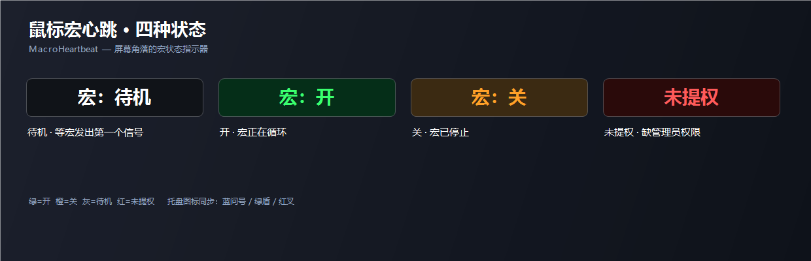

# MouseMacroHeartbeat · 鼠标宏心跳

> Is your loop macro still running, or did it stop? One glance at the corner of your screen tells you.

Add a single `F8` step to your macro, and a small badge on your desktop follows its state: **green = running, orange = stopped**.



---

## You've probably run into this

- You think the macro is running — it actually got interrupted several cycles ago
- You think the macro is off — it's still looping away in the background
- You switched windows, changed a profile, loaded another macro, and have no idea what state you're in

Every major macro tool runs macros **at the driver level**. Neither the game nor the OS exposes "is this macro still alive?"

This tool solves it in a dumb but reliable way: **have your macro press `F8` once per cycle.**

Receive an F8 → badge turns green. No F8 for a while → badge turns orange. Now you can see at a glance whether your macro is breathing.

> **It's called "Mouse" MacroHeartbeat, but it works with any macro.**
> Keyboard macro keys (G-keys, M-keys), keyboard macros, gamepad macros — anything that can squeeze one `F8` into a loop will work.
> The script only ever cares about the signal key, never about which software or device sent it.

---

## What it does

- **Four states at a glance**: grey = idle, green = on, orange = off, red = not elevated
- **Tray icon changes with state**: blue question mark / green shield / red cross
- **Audio cue**: high beep when the macro starts, low beep when it stops
- **Adapts to your macro's timing**: change the macro's pace, no code changes needed
- **No injection, no memory reads, no gameplay automation**: it listens to one key and draws a badge

---

## Quick start (3 steps)

**1. Install AutoHotkey v2**

Download and install from <https://www.autohotkey.com/>. You need **v2.0 or later** — **not** v1.1, the two are syntax-incompatible.

**2. Double-click `鼠标宏心跳.ahk`**

Accept the UAC prompt. A blue question-mark icon appears in the tray, and a grey `宏：待机` badge shows in the bottom-right corner.

> The script needs administrator rights to install a global keyboard hook. Keeping it in a normal folder (rather than `C:\Program Files`) makes life easier.

**3. Add one F8 step to your macro**

Open your loop macro, add a **"Keyboard key F8"** action, and save.

> ⚠️ Put it **inside the loop**, and **only once per cycle**.
> Outside the loop it fires a single time, and the script will assume the macro has stopped.

---

## Adding F8 in common macro tools

| Tool | Where to add it |
|---|---|
| Logitech G HUB | Macro editor → action list → add "Keyboard key" → press F8 → save |
| Razer Synapse | Macro module → record or add a keystroke → F8 |
| Corsair iCUE | Actions → Macro → add key F8 |
| SteelSeries GG | Engine → macro editor → add key F8 |
| Other vendor drivers | Look for "Macro" → add action → keyboard → F8 |
| Open-source alternatives | Same idea: insert a keyboard F8 into the sequence |

**General rules** (more important than any specific menu path):

1. F8 must be **inside the loop body**, hit once per cycle
2. **Only one F8 per cycle** — two and the measured interval halves, which breaks the timing maths
3. The macro can be bound to any key (G4 / G5 / middle mouse / keyboard key) — the script doesn't care

---

## FAQ

**Q: The badge flashes green-orange-green.**

The timeout is shorter than one macro cycle. Normally the script measures this itself (`AutoTimeout := true`) and calibrates after two cycles.

If it still flashes, compute it manually: **timeout = cycle length + 2000 ms**. Add up every delay in the macro to get the cycle length.

**Q: Nothing happens, the badge stays grey.**

Open `signal.log` in the script's folder:

- Lines with `RX` → the signal is arriving; the problem is on the display side
- No `RX` lines → the signal never arrives. Check:
  1. Does the first log line say `admin=1`? If not, the script isn't elevated
  2. Is the F8 step actually in the macro? Is it outside the loop?
  3. Is F8 claimed by another program?

**Q: The badge is red and says `未提权` (not elevated).**

You declined the UAC prompt. Quit the script, start it again, and click "Yes".

**Q: F8 conflicts with a game binding.**

Right-click the tray icon → "Change signal key", then press the key you want (applies to this session).

To make it permanent, edit `SignalKey := "F10"` (or `"Pause"`, `"ScrollLock"`) at the top of the script and update the macro to match.

**Q: The badge disappears inside the game.**

If the game is in fullscreen-exclusive mode, no always-on-top window can draw over it. Switch to borderless or windowed-fullscreen.

**Q: Why does it take ~7 seconds to turn orange after I stop the macro?**

Because it has to wait for "the next F8 that never arrives" before it can be sure. The detection time can never be shorter than one macro cycle — that's inherent to the design, not lag.

**Q: Auto-start at login without a UAC prompt every time?**

Create a Task Scheduler task: trigger = at logon, and tick "Run with highest privileges". Then delete the old shortcut from your Startup folder, otherwise you'll get two instances and two overlapping badges.

---

## Configuration

Everything lives at the **top of `鼠标宏心跳.ahk`**. Edit with Notepad, then right-click the tray icon → Reload Script.

| Option | Default | Purpose |
|---|---|---|
| `SignalKey` | `"F8"` | The signal key. Change it here and in your macro |
| `PassThroughSignalKey` | `false` | `false` = swallow F8 so the game never sees it |
| `AutoTimeout` | `true` | Measure the timeout automatically |
| `F8Timeout` | `8000` | Fixed timeout, only used when `AutoTimeout=false` |
| `TimeoutFactor` | `1.05` | Auto timeout = median × this factor + `TimeoutPadMs` |
| `TimeoutPadMs` | `400` | Extra headroom in milliseconds |
| `SoundOn` | `true` | Beep on state changes |
| `SelfTestKey` | `"F9"` | Self-test key — pressing it simulates a signal |
| `OsdCorner` | `"BR"` | Badge corner: `BR` / `BL` / `TR` / `TL` |
| `OsdMarginX` | `24` | Distance from screen edge, horizontal (px) |
| `OsdMarginY` | `12` | Distance from screen edge, vertical (px) |
| `OsdFontSize` | `19` | Font size (or use Tray → Appearance, 10–40) |
| `OsdAlpha` | `245` | Opacity (60–255; also adjustable under Appearance) |
| `OsdShowIdle` | `true` | Show the badge while idle |
| `FollowForegroundMonitor` | `true` | Move the badge to the monitor that owns the active window |
| `MonitorIndex` | `1` | Fixed monitor index when not following |
| `AutoElevate` | `true` | Request elevation automatically when needed |
| `LogEnabled` | `true` | Write `signal.log` |

---

## How it works

### Why send F8 instead of listening for the side button

Macros from every vendor run **at the driver level**. Side-button events never reach the system input queue as ordinary key presses, so a script can't hear them — and doesn't need to.

So we invert it: **the macro announces itself.** One F8 per cycle, and every F8 the script receives means "the macro is still alive".

That decouples everything:

| You change | Script needs changing? |
|---|---|
| Trigger key (G4 → G5) | No |
| Mouse / macro software | No |
| Order of skills in the macro | No |
| Pace of the macro | No (timeout is measured automatically) |

### Heartbeat logic

```
F8 received  → store timestamp, badge turns green
             ↓
Every 250 ms: now - last timestamp > timeout ?
             ↓
yes  → macro considered stopped, badge turns orange
```

### How the timeout is computed

The script keeps the last 5 F8 intervals and takes the **median** (not the mean, so a single stutter doesn't skew it):

```
timeout = median × 1.05 + 400 ms
```

Measured on a real 6414 ms macro: intervals came out at 6468–6500 ms, giving a timeout of 7190–7230 ms, and the badge turned orange about 7.3 s after the macro stopped.

For a fixed value, set `AutoTimeout := false` and `F8Timeout = cycle length + 2000`.

> ⚠️ If the timeout is shorter than the cycle length, the badge blinks orange once per cycle and beeps the low tone while the macro is still running.

### Permissions

The script requires **administrator rights** because:

- Games often run elevated, and a normal-privilege process is blocked by UIPI from seeing keys destined for a higher-privilege process
- Global keyboard hooks and always-on-top overlays need the privileges

### Log format

Three line types matter in `signal.log`:

```
RX signal -> ON             first signal seen, macro considered on
INTERVAL 6484ms             gap between two signals
AUTO timeout -> 7209ms      newly computed timeout
TIMEOUT 7312ms > 7209ms     timed out, macro considered off
```

When troubleshooting, check whether any `RX` line exists — that alone splits the problem in half.

---

## Disclaimer

This tool **does not inject into the game, does not read or write game memory, and does not play the game for you**. It listens to one key that your own macro emits, and draws a window.

It does require **administrator rights and a global keyboard hook**. Some anti-cheat systems are sensitive to that class of software, so **use it at your own risk in competitive online games**.

Whether using automation macros complies with a given game's terms of service is your call and your responsibility.

### Will this get me banned?

**No tool can promise that, including this one.**

What can be said clearly:

- The script only **listens and draws a window**; it never touches the game process
- It swallows F8 (`PassThroughSignalKey := false`), so the game never receives that key at all
- It does hook the keyboard globally, and that behaviour is observable to anti-cheat

**What actually gets macros detected is the macro itself, not this indicator:**

- Perfectly constant intervals (say 533 ms every time, for hours)
- Human input varies 20–40%; machines don't
- Detection code just computes the standard deviation of intervals — near zero gives it away

So if that worries you, changing the macro helps more than changing this script: add a little random jitter to each delay, and don't leave it running unattended for hours.

---

## 中文

中文版说明见 [README.md](README.md)。

---

## License

[MIT](LICENSE). Built on [AutoHotkey v2](https://www.autohotkey.com/).

> When reporting a problem, please attach `signal.log`.
